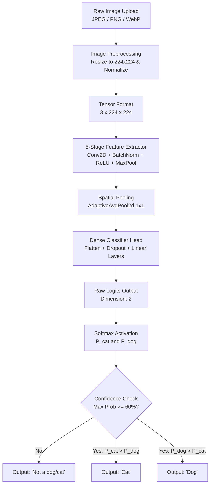
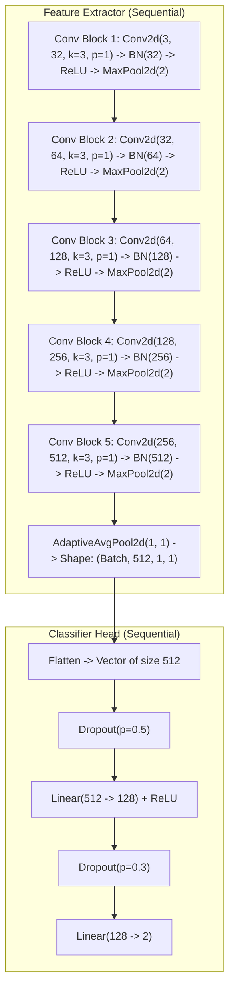
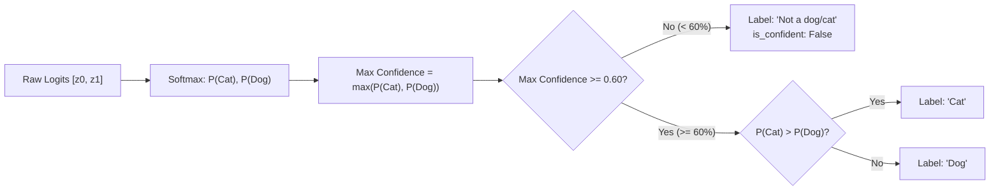

#  Model Explanation & Architecture — petsnap.ai

This document provides a comprehensive technical breakdown of the deep learning classification model powering **petsnap.ai**, including data flow, layer specifications, and the confidence guardrail mechanism.

---

## 1. High-Level Architecture Overview

The underlying model is a custom deep **Convolutional Neural Network (CNN)** implemented in PyTorch (`CatDogCNN`). It transforms raw, variable-sized RGB pet images into normalized species probabilities and applies an uncertainty threshold to prevent false-positive classifications.



---

## 2. Detailed Layer-by-Layer Architecture

The neural network is split into two primary modules:
1. **Feature Extractor (`features`)**: Extracts spatial hierarchies from low-level edges up to complex facial features.
2. **Classifier Head (`classifier`)**: Projects condensed representations into class logits.



### Tensor Dimensions Through the Network

| Stage | Input Shape | Layer / Operation | Output Shape | Feature Representation |
| :--- | :--- | :--- | :--- | :--- |
| **Input** | `(B, 3, H, W)` | Resize + Normalization | `(B, 3, 224, 224)` | Normalized RGB pixel tensor |
| **Block 1** | `(B, 3, 224, 224)` | Conv2d(32) + BN + ReLU + Pool | `(B, 32, 112, 112)` | Edges, gradients, color contrasts |
| **Block 2** | `(B, 32, 112, 112)` | Conv2d(64) + BN + ReLU + Pool | `(B, 64, 56, 56)` | Textures, fur patterns, simple curves |
| **Block 3** | `(B, 64, 56, 56)` | Conv2d(128) + BN + ReLU + Pool | `(B, 128, 28, 28)` | Eye contours, ear points, snout shapes |
| **Block 4** | `(B, 128, 28, 28)` | Conv2d(256) + BN + ReLU + Pool | `(B, 256, 14, 14)` | Distinct facial structures & body poses |
| **Block 5** | `(B, 256, 14, 14)` | Conv2d(512) + BN + ReLU + Pool | `(B, 512, 7, 7)` | High-level semantic animal features |
| **Pooling** | `(B, 512, 7, 7)` | AdaptiveAvgPool2d(1) | `(B, 512, 1, 1)` | Spatially condensed channel descriptors |
| **Flatten** | `(B, 512, 1, 1)` | Flatten + Dropout(0.5) | `(B, 512)` | 1D feature vector per image |
| **Dense 1**| `(B, 512)` | Linear(512, 128) + ReLU + Dropout(0.3) | `(B, 128)` | Compressed high-level abstraction |
| **Output** | `(B, 128)` | Linear(128, 2) | `(B, 2)` | Unnormalized logits `[z_cat, z_dog]` |

---

## 3. Data Preprocessing Pipeline

Every input image undergoes standardization before passing into the neural network:

1. **Format Validation**: Ensures file format is JPEG, PNG, or WebP under 5 MB.
2. **RGB Conversion**: Standardizes 1-channel grayscale or 4-channel RGBA formats to 3-channel RGB.
3. **Resizing**: Scales image dimensions to `224 × 224` pixels.
4. **Tensor Conversion**: Converts `[0, 255]` pixel integers to PyTorch floats `[0.0, 1.0]`.
5. **Channel Normalization**:
   - Mean: `[0.485, 0.456, 0.406]`
   - Standard Deviation: `[0.229, 0.224, 0.225]`
   - Scales pixel distribution to match standard pretrained computer vision expectations.

---

## 4. Confidence Guardrail & Out-Of-Distribution Handling

Traditional binary image classifiers apply the standard Softmax function:

$$\sigma(z)_i = \frac{e^{z_i}}{\sum_{j=1}^K e^{z_j}}$$

Because binary classifiers have outputs that sum to 100%, an image of a **car**, **shoe**, or **coffee mug** would typically produce a probability like 52% Cat vs 48% Dog, forcing a misleading "Cat" label.

### The 60% Threshold Guardrail

In **petsnap.ai**, a decision boundary check is enforced:



- When the model is uncertain or the input does not exhibit strong feline or canine features, the maximum class probability remains near 50%.
- If confidence $< 0.60$, the system avoids guessing and assigns the label **"Not a dog/cat"**.

---

## 5. Model Performance Metrics

The trained weights (`best_catdog_model.pth`) achieved the following validation results:

| Metric | Score | Explanation |
| :--- | :--- | :--- |
| **Accuracy** | **89.58%** | Ratio of correct classifications out of total samples |
| **Precision** | **87.09%** | Accuracy of positive cat/dog predictions |
| **Recall** | **92.79%** | Sensitivity in identifying true positive pet samples |
| **F1 Score** | **89.85%** | Harmonic mean of precision and recall |

### Confusion Matrix

```
                Predicted Cat    Predicted Dog
Actual Cat          522               82
Actual Dog           43              553
```

- **True Negatives (Cat → Cat)**: 522
- **False Positives (Cat → Dog)**: 82
- **False Negatives (Dog → Cat)**: 43
- **True Positives (Dog → Dog)**: 553

---

## 6. Production Deployment (ONNX Runtime)

To run within Render's free tier (512 MB RAM limit) without memory exhaustion, the model is exported to Open Neural Network Exchange format (`best_catdog_model.onnx`):
- **Memory Footprint**: Peak RAM is reduced from ~450+ MB under full PyTorch down to **~40 MB** under ONNX Runtime CPU.
- **Size Optimization**: The ONNX file is **6.24 MB** (down from the 19.68 MB PyTorch checkpoint) by pruning training optimizer states.
- **Inference Latency**: Single image CPU inference completes in ~15-30ms with identical mathematical output parity (max diff < 1e-6).
